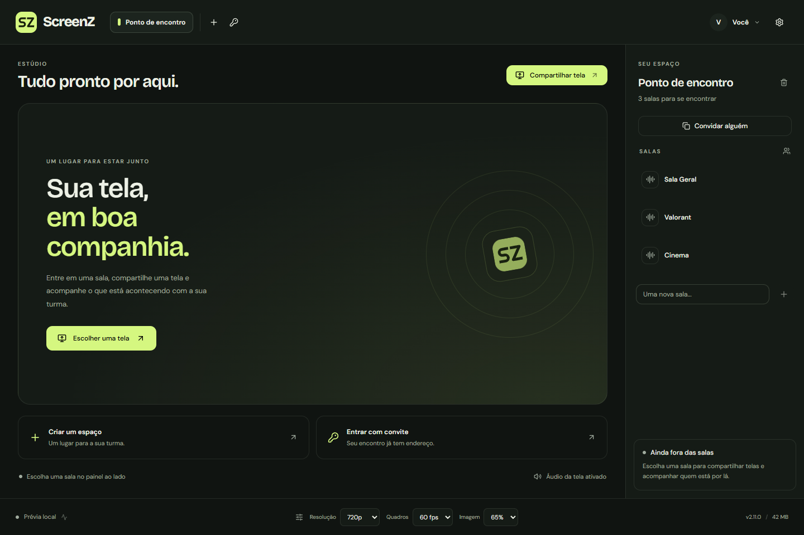

# ScreenZ


**Sua tela, em boa companhia.**

Um estúdio desktop para compartilhar aplicativos, jogos e monitores com quem está na sua sala. Backend em Rust, interface em React e janelas gerenciadas pelo Tauri 2.

## O estúdio



- **Espaços na navegação superior** para alternar entre seus grupos e acessar convites.
- **Salas no painel direito**, com participantes e indicação de quem está transmitindo.
- **Telas no centro**, com foco individual, reorganização, tela cheia e janelas para outros monitores.
- **Qualidade à mão**, com resolução, taxa de quadros e qualidade de imagem no rodapé.
- **Identidade própria**, com grafite, verde-lima, tipografia DM Sans e Bricolage Grotesque, além de temas e perfil personalizáveis.

O ScreenZ usa o monograma **SZ** como logo. Os espaços usam o sistema de servidores e convites existente, com suporte aos códigos anteriores.

## Começar

1. Abra `ScreenZ.exe` (ou `Iniciar ScreenZ.bat`) e escolha seu nome e, opcionalmente, uma foto.
2. Crie um espaço pelo botão **+** ou use **Entrar com convite**.
3. Escolha uma sala no painel direito.
4. Clique em **Compartilhar tela**, selecione um aplicativo ou monitor e ajuste o áudio.

Em uma transmissão, use os controles da tela para focar, mover, abrir em outro monitor ou entrar em tela cheia. O botão de parada fica no cabeçalho do estúdio.

O perfil é local e fica salvo em `%APPDATA%/ScreenZ/account_v2.conf` no Windows. No Linux/macOS, fica em `$XDG_CONFIG_HOME/ScreenZ/account_v2.conf` ou `~/.config/ScreenZ/account_v2.conf`. Na primeira abertura, o ScreenZ importa automaticamente o perfil da antiga pasta `SZdisc`, preservando o arquivo original e dando prioridade a um perfil ScreenZ já existente.

## Captura e transmissão

As opções disponíveis são 1080p, 900p, 720p, 480p e 360p, com 60, 30 ou 15 fps. A taxa efetiva depende da captura, do conteúdo e da conexão.

| Plataforma | Implementação |
| --- | --- |
| Windows | Captura DXGI com fallback GDI e captura de áudio WASAPI |
| Linux e macOS | Captura de tela por `xcap` e reprodução de áudio por `cpal`. A captura de áudio do sistema precisa de implementação |

A conexão dos espaços e salas usa túneis e descoberta pelo serviço `bore.pub`. O vídeo usa quadros JPEG e o áudio usa PCM. As janelas recebem vídeo por um WebSocket binário local.

## Desenvolver

Instale Node.js 22.12+ e Rust estável.

No Windows, instale WebView2 e C++ Build Tools com Windows SDK e prepare a toolchain MSVC.

```powershell
rustup toolchain install stable-msvc
npm --prefix ScreenZWeb ci --legacy-peer-deps
npm --prefix ScreenZWeb run desktop:dev
```

No Linux, instale as dependências do Tauri, incluindo WebKitGTK 4.1, GTK 3, AppIndicator, além das bibliotecas de captura e áudio usadas no projeto. A lista usada na compilação está em [.github/workflows/release.yml](.github/workflows/release.yml).

O comando `desktop:dev` inicia o Vite e o aplicativo Tauri, com atualização automática da interface. Para trabalhar somente na interface web, execute `npm --prefix ScreenZWeb run dev`. Quando o backend está fechado, o navegador usa uma prévia local com dados simulados.

## Compilar

```powershell
npm --prefix ScreenZWeb run desktop:build
```

O executável fica em `target/release/screenz.exe` no Windows e em `target/release/screenz` no Linux/macOS. A interface, os ícones e as fontes são empacotados no aplicativo. Na cópia local do projeto, `ScreenZ.exe` permite abrir a versão compilada diretamente.

O identificador desktop é `com.screenz.desktop`, e o pacote do frontend é `screenz-web`, na pasta `ScreenZWeb`. Para desativar a consulta e a instalação de atualizações, defina `SCREENZ_DISABLE_UPDATER`. Em builds diretos com Cargo, `SCREENZ_SKIP_WEB_BUILD` permite usar o `dist` já compilado.

## Verificar o código

```powershell
npm --prefix ScreenZWeb run lint
npm --prefix ScreenZWeb test
```

Com o ambiente C++ do Windows configurado, execute também `cargo +stable-msvc test` e `cargo +stable-msvc clippy --all-targets -- -D warnings`. No Linux/macOS, use `cargo test` e `cargo clippy --all-targets -- -D warnings`.

## Organização

| Caminho | Responsabilidade |
| --- | --- |
| `ScreenZWeb/src/sections/navigation` | Navegação por espaços |
| `ScreenZWeb/src/sections/rooms` | Salas, convites e participantes |
| `ScreenZWeb/src/sections/stage` | Área de transmissão e qualidade |
| `ScreenZWeb/src/sections/modals` | Compartilhamento, ajustes e diagnóstico |
| `ScreenZWeb/src/services` | Comunicação IPC/HTTP, vídeo e temas |
| `src/desktop.rs` | Runtime Tauri, instância única e janelas |
| `src/core`, `src/capture`, `src/audio`, `src/network` | Estado, captura, áudio e conexão |

O tema **SZ Original** atualiza a antiga paleta padrão. As cores de temas personalizados são preservadas durante a leitura dos perfis existentes.

As fontes são distribuídas com suas licenças [DM Sans](ScreenZWeb/public/licenses/dm-sans.txt) e [Bricolage Grotesque](ScreenZWeb/public/licenses/bricolage-grotesque.txt).

## Downloads publicados

Consulte os arquivos disponíveis na [página de releases](https://github.com/VitorOliveiraGomes/SZdisc/releases). As próximas compilações da automação usam os nomes `ScreenZ-Windows-x64.exe`, `ScreenZ-Linux-x64`, `ScreenZ-macOS-arm64` e `ScreenZ-macOS-x64`.

No Linux/macOS, dê permissão de execução ao arquivo baixado, por exemplo: `chmod +x ScreenZ-Linux-x64`.
