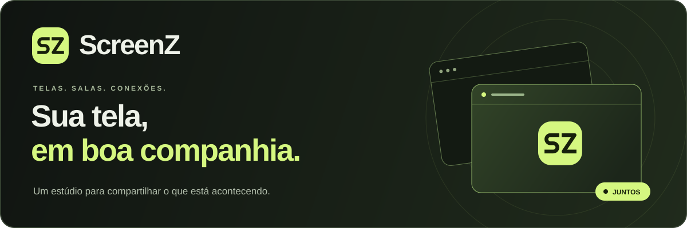
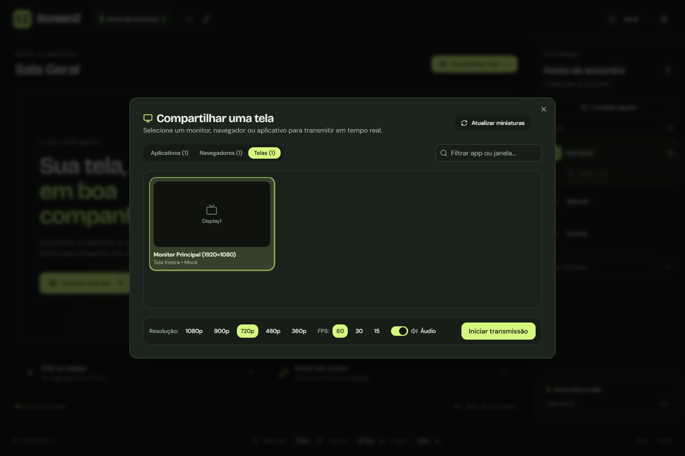
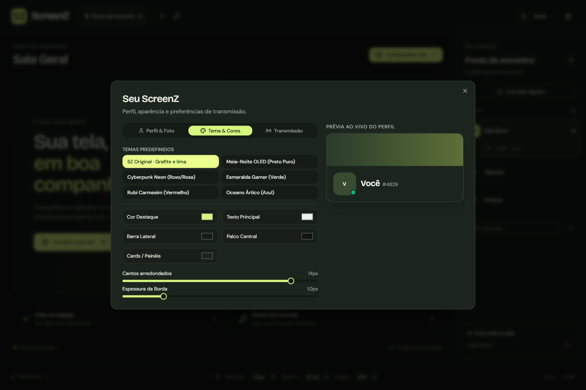

<h1 align="center">
  
</h1>

<p align="center">
  Compartilhe jogos, aplicativos e momentos com quem está na sua sala.<br />
  Um estúdio desktop com espaços para sua turma e telas para acompanhar de perto.
</p>

<p align="center">
  <a href="https://github.com/VitorOliveiraGomes/ScreenZ/releases/latest"></a>
  <a href="https://github.com/VitorOliveiraGomes/ScreenZ/actions/workflows/release.yml"></a>
  
  
  
</p>

<p align="center">
  <a href="#downloads"><strong>Baixar ScreenZ</strong></a> &nbsp;·&nbsp;
  <a href="#o-estúdio">Conhecer o estúdio</a> &nbsp;·&nbsp;
  <a href="#desenvolvimento">Desenvolver</a> &nbsp;·&nbsp;
  <a href="https://github.com/VitorOliveiraGomes/ScreenZ/issues">Relatar um problema</a>
</p>

## Downloads

Escolha sua plataforma e entre na sua próxima sala.

> [!WARNING]
> **O ScreenZ ainda não possui assinatura digital no Windows.** Ao baixar ou abrir o aplicativo, o Windows pode exibir avisos como “Fornecedor desconhecido” ou “O Windows protegeu o computador”.
>
> Um aviso de reputação não é o mesmo que uma detecção de malware. Se o antivírus identificar uma ameaça, não ignore a detecção: [abra uma issue](https://github.com/VitorOliveiraGomes/ScreenZ/issues/new) com a versão do aplicativo e o nome da ameaça para investigação. Baixe somente pelas [releases oficiais deste repositório](https://github.com/VitorOliveiraGomes/ScreenZ/releases).

| Windows | Linux | macOS |
| :---: | :---: | :---: |
| **[Baixar para Windows x64](https://github.com/VitorOliveiraGomes/ScreenZ/releases/latest/download/ScreenZ-Windows-x64.exe)** | **[Baixar para Linux x64](https://github.com/VitorOliveiraGomes/ScreenZ/releases/latest/download/ScreenZ-Linux-x64)** | **[Apple Silicon](https://github.com/VitorOliveiraGomes/ScreenZ/releases/latest/download/ScreenZ-macOS-arm64)** · **[Intel](https://github.com/VitorOliveiraGomes/ScreenZ/releases/latest/download/ScreenZ-macOS-x64)** |

No Windows, é necessário o **WebView2**. No Linux/macOS, dê permissão de execução ao arquivo baixado, por exemplo: `chmod +x ScreenZ-Linux-x64`.

> **Sobre o áudio:** a captura de áudio do sistema está disponível no Windows. No Linux e no macOS, essa captura ainda precisa de implementação.

As novidades e os arquivos de cada versão estão nas [notas das releases](https://github.com/VitorOliveiraGomes/ScreenZ/releases).

## O estúdio

Um espaço para se encontrar, escolher uma tela e acompanhar o que está acontecendo.

<p align="center">
  <a href="docs/images/studio.png"></a>
  <br />
  <sub>O estúdio no tema SZ Original. As prévias deste README usam dados de demonstração.</sub>
</p>

| Um espaço para sua turma | Cada tela no seu lugar | Do seu jeito |
| --- | --- | --- |
| Alterne entre grupos, entre com um convite e encontre seus amigos nas salas. | Foque uma transmissão, reorganize as telas ou abra uma janela em outro monitor. | Personalize o perfil, escolha um tema e ajuste as cores da interface. |

### Escolha o que mostrar. Deixe com a sua cara.

<table>
  <tr>
    <td width="50%" valign="top">
      <a href="docs/images/share-picker.png"></a>
      <p><strong>Uma janela ou a tela inteira</strong><br />Escolha a fonte, a resolução, os quadros por segundo e o áudio antes de transmitir.</p>
    </td>
    <td width="50%" valign="top">
      <a href="docs/images/appearance.png"></a>
      <p><strong>Um estúdio com a sua identidade</strong><br />Use os temas prontos ou combine suas próprias cores, cantos e bordas.</p>
    </td>
  </tr>
</table>

<p align="center"><sub>Clique nas imagens para ver os detalhes em tamanho maior.</sub></p>

### Da primeira abertura à primeira transmissão

1. **Apresente-se.** Abra o aplicativo e escolha seu nome e, se quiser, uma foto. Na cópia local do projeto, use `ScreenZ.exe` ou `Iniciar ScreenZ.bat`.
2. **Encontre sua turma.** Crie um espaço pelo botão **+** ou escolha **Entrar com convite** e selecione uma sala no painel direito.
3. **Traga sua tela.** Clique em **Compartilhar tela**, escolha um aplicativo ou monitor e ajuste o áudio.

Durante a transmissão, use os controles da tela para focar, mover, abrir em outro monitor ou entrar em tela cheia. Para encerrar, use o botão de parada no cabeçalho do estúdio.

<details>
<summary><strong>Qualidade, captura e conexão</strong></summary>

As resoluções disponíveis são **1080p, 900p, 720p, 480p e 360p**, com **60, 30 ou 15 fps**. Os ajustes de resolução, quadros e qualidade da imagem também ficam acessíveis no rodapé. A taxa efetiva depende da captura, do conteúdo e da conexão.

| Plataforma | Captura e áudio |
| --- | --- |
| Windows | Captura DXGI com fallback GDI e captura de áudio WASAPI |
| Linux e macOS | Captura por `xcap` e reprodução de áudio por `cpal`; captura do áudio do sistema pendente |

A conexão dos espaços e salas usa túneis e descoberta pelo serviço `bore.pub`. O vídeo usa quadros JPEG e o áudio usa PCM. As janelas recebem vídeo por um WebSocket binário local.

</details>

<details>
<summary><strong>Onde ficam meu perfil e minhas preferências?</strong></summary>

O perfil é local:

| Sistema | Arquivo |
| --- | --- |
| Windows | `%APPDATA%/ScreenZ/account_v2.conf` |
| Linux/macOS | `$XDG_CONFIG_HOME/ScreenZ/account_v2.conf` ou `~/.config/ScreenZ/account_v2.conf` |

Na primeira abertura, o ScreenZ importa o perfil da antiga pasta `SZdisc`, preservando o arquivo original e dando prioridade a um perfil ScreenZ já existente. Os códigos de convite anteriores continuam funcionando.

O tema **SZ Original** atualiza a antiga paleta padrão. As cores de temas personalizados são preservadas na leitura dos perfis existentes.

</details>

## Desenvolvimento

O ScreenZ combina **Rust** para captura, áudio e conexão, **React + TypeScript** na interface e **Tauri 2** para as janelas desktop.

<details>
<summary><strong>Prepare o ambiente</strong></summary>

Instale **Node.js 22.12+** e **Rust estável**.

- **Windows:** WebView2 e C++ Build Tools com Windows SDK. Prepare a toolchain com `rustup toolchain install stable-msvc`.
- **Linux:** bibliotecas do Tauri, incluindo WebKitGTK 4.1, GTK 3 e AppIndicator, além das dependências de captura e áudio.
- **macOS:** ferramentas de desenvolvimento da Apple, incluindo os Command Line Tools do Xcode, e Rust para a arquitetura desejada.

A configuração usada nos builds está em [`.github/workflows/release.yml`](.github/workflows/release.yml), incluindo a lista de pacotes do Linux e os alvos do macOS.

</details>

### Rode o aplicativo

Na raiz do projeto, com os pré-requisitos instalados:

```powershell
npm --prefix ScreenZWeb ci --legacy-peer-deps
npm --prefix ScreenZWeb run desktop:dev
```

O comando inicia o Vite e o aplicativo Tauri, com atualização automática da interface. Para trabalhar somente no navegador, execute `npm --prefix ScreenZWeb run dev`. Quando o backend está fechado, a interface usa uma prévia com dados simulados.

### Compile e verifique

| Objetivo | Comando na raiz |
| --- | --- |
| Compilar o desktop | `npm --prefix ScreenZWeb run desktop:build` |
| Compilar somente a interface | `npm --prefix ScreenZWeb run build` |
| Verificar a interface | `npm --prefix ScreenZWeb run lint` |
| Testar os serviços da interface | `npm --prefix ScreenZWeb test` |

No Windows, com o ambiente C++ configurado:

```powershell
cargo +stable-msvc test
cargo +stable-msvc clippy --all-targets -- -D warnings
```

No Linux/macOS, use `cargo test` e `cargo clippy --all-targets -- -D warnings`.

O build desktop gera `target/release/screenz.exe` no Windows e `target/release/screenz` no Linux/macOS. A interface, os ícones e as fontes são incorporados ao aplicativo.

<details>
<summary><strong>Identificadores e opções de build</strong></summary>

| Opção | Uso |
| --- | --- |
| `com.screenz.desktop` | Identificador do aplicativo Tauri |
| `screenz-web` | Nome do pacote do frontend, em `ScreenZWeb/` |
| `SCREENZ_DISABLE_UPDATER` | Desativa a consulta e a instalação de atualizações |
| `SCREENZ_SKIP_WEB_BUILD` | Em builds diretos com Cargo, usa o `dist` já compilado |

</details>

## Por dentro do ScreenZ

| Parte | Onde encontrar |
| --- | --- |
| Espaços, salas e área de transmissão | [`ScreenZWeb/src/sections`](ScreenZWeb/src/sections) |
| Comunicação IPC/HTTP, vídeo e temas | [`ScreenZWeb/src/services`](ScreenZWeb/src/services) |
| Janelas, instância única e runtime Tauri | [`src/desktop.rs`](src/desktop.rs) |
| Estado e comandos do aplicativo | [`src/core`](src/core) |
| Captura, áudio e conexão | [`src/capture`](src/capture) · [`src/audio`](src/audio) · [`src/network`](src/network) |
| Perfil e preferências | [`src/config`](src/config) |

Para entender os módulos e seus pontos de integração, consulte o [guia de arquitetura](docs/ARQUITETURA.md).

### Quer participar?

Encontrou um problema? [Abra uma issue](https://github.com/VitorOliveiraGomes/ScreenZ/issues/new) com seu sistema, os passos para reproduzir e o comportamento esperado. Ideias para a interface e melhorias no compartilhamento também são bem-vindas.

Para alterações de código, execute as verificações acima e descreva no pull request o que mudou e como foi validado.

---

<p align="center">
  <br />
  <strong>ScreenZ · Sua tela, em boa companhia.</strong><br />
  <sub>Fontes distribuídas com suas licenças: <a href="ScreenZWeb/public/licenses/dm-sans.txt">DM Sans</a> e <a href="ScreenZWeb/public/licenses/bricolage-grotesque.txt">Bricolage Grotesque</a>.</sub>
</p>
